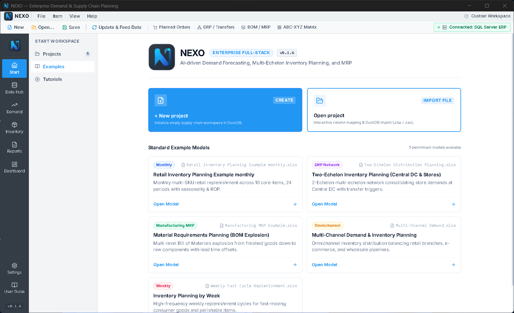

# NEXO — Enterprise Demand & Supply Chain Planning
[]() []() []() []() []()

**NEXO** is a native Windows desktop enterprise planning platform engineered for statistical demand forecasting, dynamic inventory replenishment, and multi-source ERP data integration.

<p align="center">
  
</p>

---

## Core Capabilities (<!-- VERSION_START -->v0.1.17<!-- VERSION_END -->)
- **Full-DB DuckDB Analytics & Enterprise Integrity:** Dedicated backend analytics evaluating 100% of SKUs in DuckDB (>197k rows across multi-branch topologies, zero 50-row UI slice truncation) for Planned POs, Multi-Echelon DRP rebalancing, MRP explosion, and ABC-XYZ matrices; collision-free full UUID keys; automated swapped sales anomaly repair; and unit-based periodic review replenishment with anti-dead-SKU seasonal guards.
- **Statistical Demand Forecasting:** Automated model selection (Seasonal Holt-Winters, Croston SBA Intermittent, Linear OLS, Moving Average) with inline planner overrides and 95% confidence intervals.
- **Dynamic Inventory Replenishment:** Real-time Safety Stock, Reorder Point (ROP), MOQ & batch rounding, Periodic JIT vs. Min/Max policies, and ABC/XYZ portfolio classification.
- **Enterprise Pure-Python Excel Engine:** Full-dataset RTL Excel (.xlsx) exports with dark navy styling, AutoFilter, frozen panes, and zero native/unsigned binaries (100% Windows 11 Smart App Control compliant).
- **Unified Data Hub:** Direct Microsoft SQL Server ERP sync via ODBC, Excel/CSV ingestion with downloadable templates, local DuckDB/SQLite import, and REST API/Google Sheets connectors.
- **Native Desktop Runtime:** Single-process Windows application powered by Edge WebView2, FastAPI, and persistent DuckDB storage with native Windows Save As file dialogs.
- **Over-The-Air (OTA) Auto-Updater:** Built-in GitHub release detector with one-click download, rebuild, and restart while preserving local workspace databases.

---

## Quick Installation

### Option 1: One-Line PowerShell Installer (Recommended — Works Without Git)
Open **PowerShell** and execute the command below to download NEXO, provision dependencies, build the desktop bundle, and create a Desktop shortcut:
```powershell
$dest = "$env:USERPROFILE\NEXO"; New-Item -ItemType Directory -Force -Path $dest | Out-Null; Invoke-WebRequest -Uri "https://github.com/Ramisharafaldin/NEXO-Enterprise-Desktop-App/archive/refs/heads/main.zip" -OutFile "$dest\nexo.zip"; Expand-Archive -Path "$dest\nexo.zip" -DestinationPath $dest -Force; Copy-Item "$dest\NEXO-Enterprise-Desktop-App-main\*" -Destination $dest -Recurse -Force; Remove-Item "$dest\NEXO-Enterprise-Desktop-App-main","$dest\nexo.zip" -Recurse -Force; Set-Location $dest; .\setup.bat
```

### Option 2: Windows Command Prompt (CMD)
Open **Command Prompt (`cmd.exe`)** and execute:
```cmd
mkdir "%USERPROFILE%\NEXO" 2>nul & cd /d "%USERPROFILE%\NEXO" & curl -L "https://github.com/Ramisharafaldin/NEXO-Enterprise-Desktop-App/archive/refs/heads/main.zip" -o nexo.zip & tar -xf nexo.zip --strip-components=1 & del nexo.zip & setup.bat
```

### Option 3: Developer Access
* **Developer:** Rami Sharafaldin
* **Email:** [r.sharafaldin@gmail.com](mailto:r.sharafaldin@gmail.com)

> To obtain the developer repository link and setup access, please send a request via email.

---

## Updating NEXO
- **In-App One-Click Update:** Whenever new commits are pushed to GitHub, NEXO displays a notification banner at the top of the workspace. Click **Update & Restart Now** to pull changes, recompile the UI, and relaunch automatically without touching local data (`backend/nexo_workspace.duckdb`).
- **Manual Terminal Update:**
```powershell
git pull
npm run build
```

---

## System Requirements
- **OS:** Windows 10 / Windows 11 (64-bit) with Microsoft Edge WebView2 Runtime
- **Runtime:** Python 3.10+ & Node.js 18+ *(automatically provisioned via `winget` by `setup.bat` if missing)*
